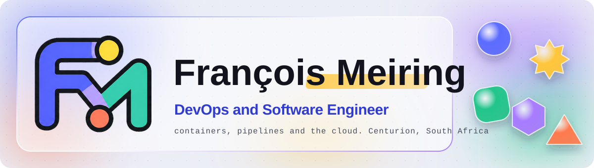

  <picture>
    <source media="(prefers-color-scheme: dark)" srcset="./.github/assets/banner-dark.svg">
    
  </picture>

  

  
  
  
  
  
  

  
  
  

  <picture>
    <source media="(prefers-color-scheme: dark)" srcset="https://cdn.jsdelivr.net/gh/Francois0203/Francois0203@output/snake-dark.svg">
    <source media="(prefers-color-scheme: light)" srcset="https://cdn.jsdelivr.net/gh/Francois0203/Francois0203@output/snake-light.svg">
    
  </picture>

---

## Hi, I am Fran&ccedil;ois

**In plain words:** I keep websites and apps running smoothly behind the scenes, and I build websites for small businesses.

**In engineering words:** I work on the side of software that gets it into production and keeps it there. That means **containers, CI/CD pipelines and the cloud** underneath them.

<table>
<tr>
<td width="33%" valign="top">

**Now**

Junior Software Developer at **Shareforce**
 Django platform on Heroku and AWS

</td>
<td width="33%" valign="top">

**Before**

One of two developers who rebuilt **Aquatico Scientific's** operational software
 Docker and Kubernetes in production

</td>
<td width="34%" valign="top">

**Next**

AWS Certified Cloud Practitioner exam booked
 MSc. Computer Science North-West University

</td>
</tr>
</table>

Away from the keyboard you will find me at the gym, on the squash court, on a hiking trail, or working through a guitar piece.

---

## Experience

| Period | Role | Organisation |
|:--|:--|:--|
| `May 2026 - Present` | **Junior Software Developer** | **Shareforce (Pty) Ltd** &nbsp;Melrose Arch, Johannesburg |
| `Jan 2025 - Apr 2026` | **Full Stack Software Developer** | **Aquatico Scientific** &nbsp;Centurion, South Africa |
| `Aug 2020 - Sep 2020` | Waiter | Bean Tree, Krugersdorp |
| `Mar 2020 - Jul 2020` | Shop Assistant | Western Rackets |

<b>Shareforce (Pty) Ltd</b>, Junior Software Developer &nbsp; May 2026 to Present

 

Working on the core equity management platform within a structured team of senior, intermediate, and junior developers.

- **Delivery.** The deployment pipelines the platform ships through, across Heroku and AWS.
- **Platform work.** System refactor, design decisions on new features, and defect resolution against production.
- **Automation.** Building AI tooling into parts of the internal workflow.
- **Modelling and reporting.** Predictive modelling for cap tables, a new project for the company, plus TM1 and accounting reports.

**Stack.** Django and PostgreSQL, with Redis for caching, deployed across Heroku and AWS.

Working alongside more senior developers, on a platform older than my career, has done more for how I structure and test my work than anything I have built alone.

<b>Aquatico Scientific</b>, Full Stack Software Developer &nbsp; Jan 2025 to Apr 2026

 

Replaced the whole of the company's operational software over sixteen months, as one of two developers on the project. Three systems, all built new:

- **Employee Management System**
- **Laboratory Management System**
- **Project Management System**

**Architecture.** One shared repository of microservices rather than three separate products, with **email**, **label printing** and **quoting** each broken out as its own service. A **React component library published as an npm package** kept every screen across the estate visually one system.

**Stack.** React on the frontend and Node.js on the backend, with PostgreSQL as the primary database and Redis for caching. Object storage through MinIO; source control and CI/CD on GitHub. Containerised with Docker and orchestrated on Kubernetes in production.

Building at that scale with no senior engineer above us taught me the cost of decisions I was not yet experienced enough to recognise as decisions.

---

## Education

| Period | Qualification | Institution |
|:--|:--|:--|
| `2026 - Present` | **MSc. Computer Science** | North-West University, Potchefstroom |
| `2024` | **BSc. Hons. Computer Science** | North-West University, Potchefstroom |
| `2021 - 2023` | **BSc. Computer Science &amp; Statistics** | North-West University, Potchefstroom |
| `2020` | National Senior Certificate (Matric) | Ho&euml;rskool Noordheuwel |

Detail on each qualification

 

- **MSc. Computer Science.** Research-focused master's degree on astronomical data processing and the distributed computing systems it runs on.
- **BSc. Hons. Computer Science.** Honours degree specialising in advanced software engineering and computational research methodologies.
- **BSc. Computer Science &amp; Statistics.** Dual-major undergraduate degree combining computational theory with statistical analysis and data science fundamentals.
- **National Senior Certificate.** Physics, Afrikaans Home Language, English First Additional Language, Mathematics, Information Technology, Computer Applications Technology.

---

## Certifications

**AWS path.** As each exam is passed, its row gets the verified Credly badge.

| Credential | Exam | Level | Status |
|:--|:--|:--|:--|
| **AWS Certified Cloud Practitioner** | `CLF-C02` | Foundational | Exam booked |
| **AWS Certified Solutions Architect - Associate** | `SAA-C03` | Associate | Planned |
| **AWS Certified CloudOps Engineer - Associate** | `SOA-C03` | Associate | Planned |
| **AWS Certified Developer - Associate** | `DVA-C02` | Associate | Planned |
| **AWS Certified DevOps Engineer - Professional** | `DOP-C02` | Professional | Planned |

Other certifications

 

- **NAUI Open Water Scuba Diver**, National Association of Underwater Instructors, `Jun 2026`, does not expire.
- **Fire Marshal**, AETA Training Solutions, `Aug 2026`, valid to `Aug 2028`. Basic firefighting.

---

## Technical Skills

<table>
<tr>
<td valign="top" width="33%">

**Cloud &amp; Platform**

</td>
<td valign="top" width="34%">

**Delivery &amp; Building**

</td>
<td valign="top" width="33%">

**Professional**

</td>
</tr>
</table>

---

## Contribution Activity

  <picture>
    <source media="(prefers-color-scheme: dark)" srcset="https://cdn.jsdelivr.net/gh/Francois0203/Francois0203@output/activity-dark.svg">
    <source media="(prefers-color-scheme: light)" srcset="https://cdn.jsdelivr.net/gh/Francois0203/Francois0203@output/activity-light.svg">
    
  </picture>

  <picture>
    <source media="(prefers-color-scheme: dark)" srcset="https://cdn.jsdelivr.net/gh/Francois0203/Francois0203@output/stats-dark.svg">
    <source media="(prefers-color-scheme: light)" srcset="https://cdn.jsdelivr.net/gh/Francois0203/Francois0203@output/stats-light.svg">
    
  </picture>

---

## This Website

**[francois-portfolio.web.app](https://francois-portfolio.web.app/)** is built from this repository. It is made of frosted glass over a living colour field: panels with coloured rims, a light that follows your pointer, and things you can pick up and throw.

| Page | What is on it |
|:--|:--|
| **Home** | An intro that builds the FM logo from glass tiles, my photo in a box of toys you can throw around, the client sites I have built, my story as a scrolling timeline, the AWS path, and photos from off the clock. |
| **Bio** | The full CV on the page, and a **Download CV** button that builds a one-page A4 PDF in the browser from the same data. |
| **Projects** | Live client sites you can preview in place, and my GitHub repositories with their READMEs rendered on the page. |
| **Connect** | A contact form written as a letter, with a send button that shows a spinner, then a tick, or shakes if it fails. Plus my profiles and a way to support my studies. |

**How it is built**

- **Frontend.** Vite and React 19 with CSS modules. One token file holds every colour, size and timing, and one global stylesheet holds the shared glass, motion and form styles. Every component and page lives in its own folder with its own script, stylesheet and index file.
- **Feedback.** One toast system for the whole site (`toast.success`, `toast.error`, `toast.promise`), and one button that handles its own loading, success and failure states.
- **Motion.** Scroll reveals, scroll-linked depth, pointer tilt and light, tap ripples, and physics you can play with. All of it switches off with the motion toggle or the device's reduced motion setting.
- **Content.** Every word on the site lives in Firestore and is edited through a private admin page with Google sign-in, drag-to-reorder lists, photo upload, and control over what appears on the CV.
- **Contact.** A Firebase Function emails me each message sent through the contact form.
- **Automation.** GitHub Actions deploy the site on every push to `main`, sync my repositories and client sites into Firestore, and draw the graphics on this page.

The graphics on this page are generated by `.github/workflows/refresh.yml` and served from the `output` branch over jsDelivr.

---

## Selected Work

| Project | What it is |
|:--|:--|
| **[Telescope-Correlator](https://github.com/Francois0203/Telescope-Correlator)** | Signal correlation for telescope array data, the engineering side of the MSc research into distributed astronomical data processing. |
| **[Nutrition-AI](https://github.com/Francois0203/Nutrition-AI)** | Applied machine learning over nutritional data. |
| **[Francois0203](https://github.com/Francois0203/Francois0203)** | This profile and the portfolio site described above. |

The full project list, and the client sites I have built, live at **[francois-portfolio.web.app/projects](https://francois-portfolio.web.app/projects)**.

---

## Get in touch

Open to **DevOps, cloud and platform engineering** roles.

  
  
  

  DevOps &nbsp;&middot;&nbsp; Cloud &nbsp;&middot;&nbsp; CI/CD &nbsp;&middot;&nbsp; Distributed Systems

